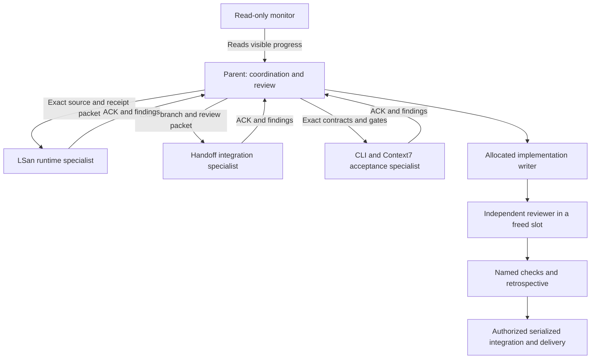

# Codex team and takeover

PLAN_ID: `2026-10-10-marketplace-macos-reflection-scaffold`.
Original source HEAD before transfer: `6b5b092efa6bdf678815073db42f69fae3f07ab3`.
Integration root: `/Users/rmanaloto/dev/github/ray-manaloto/claude-code-marketplace`.
Retained detached worktree: `/Users/rmanaloto/.codex/worktrees/2a14/claude-code-marketplace`.
Branch: `codex/marketplace-native-onboarding`.
Source-transfer baseline: `48027d2d333611d162cdff8cabb7bc1eecf944da`.
Read the selected plan and live Git identity for the current HEAD.

The canonical handoff digest is
`d4115dd495ba9445430d9b1133e20247b2f86803a8161fcd91f15322b4cedd7c`.
The parent acknowledged it read-only; the predecessor relinquished writes before
sending START. Monitor chat `01a122d7-dfe6-72c3-ab32-823fadb96690` reads visible
updates and owns no project files. No cross-thread outbound message is required.

## Current source handoff

On 2026-10-13, the reviewed A11b helper switched the published branch from the
retained worktree to the source root. Its one-shot command returned **rc 2**
after the switch because an unexpected ignored `.venv` appeared in the source
root during post-switch verification. The private journal is
`/private/tmp/a11-switch-journal-v3`; it ends `recovery_required`. Do not
replay it or reset either checkout. Independent read-only reconciliation then
confirmed source branch/HEAD, exact hashes and modes of all 8,319 tracked
files, the 12 approved source untracked entries, and the retained old
worktree's 15 dirty and 257 untracked entries. The creator of `.venv` is
unproven. It was archived before explicit source preparation; pinned tool,
dependency, static and original 19-file baseline checks passed from the
source root. The selected plan records exact exit codes and limitations.

The detached worktree still holds unrelated uncommitted edits and private
evidence. Its 932-line append-only progress delta was copied byte-for-byte
into the source-root selected plan. Other local drafts remain in place for
separate review. At that handoff, the parent held the sole implementation
writer allocation; reviewers were read-only. Later allocations follow
[Ownership](#ownership). Full Claude/container acceptance remains unrun.



## Parallel specialist execution

The user's 2026-10-13 request authorizes task-matched subagents. This session
has four concurrent slots including the parent, so use at most three workers.
Start with bounded read-only lanes; reserve a freed slot for cold review.
Nested teams do not increase that shared capacity. The selected
[execution record](../../.planning/2026-10-10-marketplace-macos-reflection-scaffold/parallel-specialists.md)
names exact agents, requested models, source identities, tools and results.

Use GPT-6.1 Sol with high effort for complex integration, contract analysis and
independent review; use GPT-6 Astra with high effort for the ambiguous native
runtime problem. Use GPT-6 Luna for bounded receipt/hash extraction that can be
checked mechanically. These are task-specific choices, not benchmarked optimality.
Reassess effort when a packet becomes routine. Each model override starts with
a fresh, narrow packet instead of inheriting the full parent history. Do not
change global settings or infer the backend's served identity from a request.

Workers get exact HEADs, input paths, a read-only tool scope, expected output,
stop conditions and the `/root` reply channel; require an ACK and status probe.
Use [bounded tool output](#bounded-tool-output) for thread and host inventories.
Only the allocated writer mutates repository files or Git state. Keep
compiler/OCI/provider runs behind their existing admissions, one heavy operation
at a time. The user-approved
[acceptance-frontier correction](../../.planning/2026-10-10-marketplace-macos-reflection-scaffold/retros/acceptance-frontier.md)
lets A06 resume after actionable defects in completed units are verified.
Future runtime gates hold only their actual dependents. Offline milestones
must pass source integration and their own checks before dependent work starts;
GitHub ticket-level blockers remain unchanged until separately amended.

## Ownership

Read-only workers share this filesystem and own no files. They preserve all edits,
report through native collaboration, acknowledge identity/objective/first action,
and answer a status probe. Record identities and reviews in the selected plan.
The parent coordinates source integration and the shared plan; edits require the
current writer allocation, including documentation and Git index changes.

Before the first edit in each unit:

1. Discover exact checkouts with `git worktree list --porcelain`. For the selected
   checkout, read its status, branch, HEAD and absolute Git common directory.
   Locate files with `rg --files` before opening inferred names. A missing path
   triggers discovery, not another guessed suffix.
2. Reconcile those observations with the latest explicit writer allocation.
   A checkout path, dirty state, task title or idle status cannot establish who
   holds it. If ownership is ambiguous, remain read-only and obtain explicit
   release from the latest evidenced holder. If another task holds it, finish
   read-only preparation and obtain its release for the bounded unit. Use
   cross-thread messaging only within the user's existing authorization.
3. Bind the release to the holder, checkout/common directory, settled HEAD,
   permitted unit and absence of in-flight writers or Git mutations. Recheck
   local identity before applying the reviewed unit. Record its checks and
   delivery, then return the allocation before starting another unit.

## Bounded tool output

`read_thread` limits turns and characters per item, not total response size.
`list_threads` may include every pinned task. Parse native results in the tool
executor and select only the fields needed for the question before display.
For an ownership ACK, select recent assistant messages and retain coverage counts.
Keep the full response and continuation cursor in ephemeral executor state;
read another page when needed to establish coverage. An excerpt cannot establish
that an omitted event did not happen.

For a one-turn read, this projection bounds the complete displayed string,
including its coverage metadata, to 6,000 JavaScript characters:

```javascript
function threadExcerpt(page) {
  const items = (page.turns ?? []).flatMap(turn => turn.items ?? []);
  const messages = items.filter(item =>
    item.type === "agentMessage" && typeof item.text === "string");
  const summary = {
    excerpt: true,
    threadId: String(page.thread?.id ?? "").slice(0, 80),
    itemsOnPage: items.length,
    messagesOnPage: messages.length,
    hasOlderPages: page.page?.hasMore === true,
    messages: messages.slice(-3).map(item => ({
      phase: String(item.phase ?? "").slice(0, 40),
      text: item.text.slice(0, 1400),
      textTruncated: item.text.length > 1400
    }))
  };
  const rendered = JSON.stringify(summary);
  const output = rendered.length <= 6000 ? rendered :
    rendered.slice(0, 5900) + "\n[TRUNCATED: narrow fields or read another page.]";
  if (output.length > 6000) throw new Error("Display budget exceeded");
  return output;
}
```

Call `text(threadExcerpt(page))` once after parsing the native JSON text block.
A parse failure is an inspection failure; report that error without dumping the
raw response. Select container IDs, state and scoped ownership fields for a host
census. For batched calls, inspect every result but budget their combined display;
keep omitted results available for a focused follow-up. Raw private metadata and
transcripts remain outside repository evidence.

## Initial onboarding admission snapshot

Prior read-only Docker census stalled; container ownership is unknown. START
explicitly admits only lightweight project work and read-only reviewer lanes.
These lanes request no Docker, port, cache, build or installation capacity. All
host-heavy work remains blocked until a fresh census and shared-capacity check.
Never terminate unknown services or infer capacity from the absence of evidence.

At START, global settings/hooks/trust/credentials, other repositories, native
goals, global mise and remote publication were outside the onboarding milestone.
Later work follows its separately recorded selected-plan authority and gates.

## Recovery

Read `.planning/2026-10-10-marketplace-macos-reflection-scaffold/task_plan.md`,
`findings.md`, and `progress.md`. Verify actual Git identity before resuming.
Use at most five maintained files and about 300 handwritten lines per unit;
record implemented, reviewed, tested, committed and published states separately.
