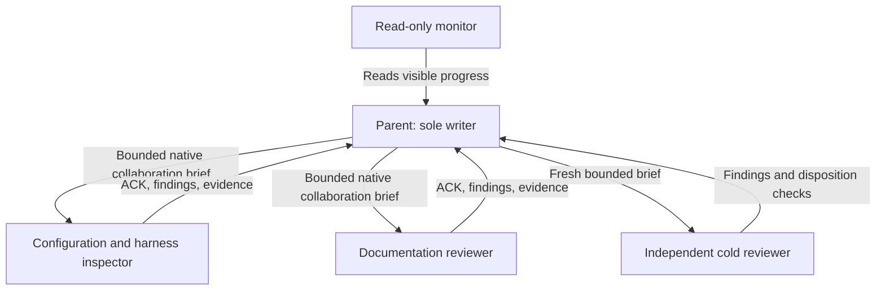

# Codex team and takeover

PLAN_ID: `2026-10-10-marketplace-macos-reflection-scaffold`.
Source HEAD: `6b5b092efa6bdf678815073db42f69fae3f07ab3`.
Worktree: `/Users/rmanaloto/.codex/worktrees/2a14/claude-code-marketplace`.
Branch: `codex/marketplace-native-onboarding`.

The canonical handoff digest is
`d4115dd495ba9445430d9b1133e20247b2f86803a8161fcd91f15322b4cedd7c`.
The parent acknowledged it read-only; the predecessor relinquished writes before
sending START. Monitor chat `01a122d7-dfe6-72c3-ab32-823fadb96690` reads visible
updates and owns no project files. No cross-thread outbound message is required.

## Ownership

Workers share this filesystem, own no files, and must preserve all edits. The
parent owns project implementation and the one selected plan. Workers report via
native collaboration, acknowledge identity/objective/first action, and answer a
status probe before their handoff is counted as live. No sidebar chats are created.
Worker identities and review receipts are recorded in the selected plan.

## Admission record

Prior read-only Docker census stalled; container ownership is unknown. START
explicitly admits only lightweight project work and read-only reviewer lanes.
These lanes request no Docker, port, cache, build or installation capacity. All
host-heavy work remains blocked until a fresh census and shared-capacity check.
Never terminate unknown services or infer capacity from the absence of evidence.

Global settings/hooks/trust/credentials, other repositories, native goals, global
mise and remote publication are outside this milestone. Global mise is a later
ownership phase with exact preimages and a reviewable patch. No chezmoi apply.

## Recovery

Read `.planning/2026-10-10-marketplace-macos-reflection-scaffold/task_plan.md`,
`findings.md`, and `progress.md`. Verify actual Git identity before resuming.
Use at most five maintained files and about 300 handwritten lines per unit;
record implemented, reviewed, tested, committed and published states separately.
