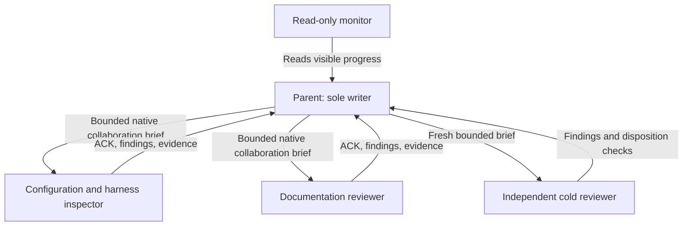

# Codex team and takeover

PLAN_ID: `2026-10-10-marketplace-macos-reflection-scaffold`.
Original source HEAD before transfer: `6b5b092efa6bdf678815073db42f69fae3f07ab3`.
Current writer root: `/Users/rmanaloto/dev/github/ray-manaloto/claude-code-marketplace`.
Retained detached worktree: `/Users/rmanaloto/.codex/worktrees/2a14/claude-code-marketplace`.
Branch: `codex/marketplace-native-onboarding`.
Verified current HEAD: `48027d2d333611d162cdff8cabb7bc1eecf944da`.

The canonical handoff digest is
`d4115dd495ba9445430d9b1133e20247b2f86803a8161fcd91f15322b4cedd7c`.
The parent acknowledged it read-only; the predecessor relinquished writes before
sending START. Monitor chat `01a122d7-dfe6-72c3-ab32-823fadb96690` reads visible
updates and owns no project files. No cross-thread outbound message is required.

## Current source handoff

On 2026-10-13, the reviewed A11b helper switched the published branch from the
retained worktree to the source root. Its one-shot command returned **rc 2**
after the switch because an unexpected ignored `.venv` appeared in the source
root during post-switch verification. The private journal is
`/private/tmp/a11-switch-journal-v3`; it ends `recovery_required`. Do not
replay it or reset either checkout. Independent read-only reconciliation then
confirmed source branch/HEAD, exact hashes and modes of all 8,319 tracked
files, the 12 approved source untracked entries, and the retained old
worktree's 15 dirty and 257 untracked entries. The creator of `.venv` is
unproven. It was archived before explicit source preparation; pinned tool,
dependency, static and original 19-file baseline checks passed from the
source root. The selected plan records exact exit codes and limitations.

The detached worktree still holds unrelated uncommitted edits and private
evidence. Its 932-line append-only progress delta was copied byte-for-byte
into the source-root selected plan. Other local drafts remain in place for
separate review. The parent is the only implementation writer across this Git
common directory under the current AGENTS.md instruction; reviewers are
read-only. Full Claude/container acceptance remains unrun.

## Ownership

Workers share this filesystem, own no files, and must preserve all edits. The
parent owns project implementation and the one selected plan. Workers report via
native collaboration, acknowledge identity/objective/first action, and answer a
status probe before their handoff is counted as live. No sidebar chats are created.
Worker identities and review receipts are recorded in the selected plan.

## Initial onboarding admission snapshot

Prior read-only Docker census stalled; container ownership is unknown. START
explicitly admits only lightweight project work and read-only reviewer lanes.
These lanes request no Docker, port, cache, build or installation capacity. All
host-heavy work remains blocked until a fresh census and shared-capacity check.
Never terminate unknown services or infer capacity from the absence of evidence.

At START, global settings/hooks/trust/credentials, other repositories, native
goals, global mise and remote publication were outside the onboarding milestone.
Later work follows its separately recorded selected-plan authority and gates.

## Recovery

Read `.planning/2026-10-10-marketplace-macos-reflection-scaffold/task_plan.md`,
`findings.md`, and `progress.md`. Verify actual Git identity before resuming.
Use at most five maintained files and about 300 handwritten lines per unit;
record implemented, reviewed, tested, committed and published states separately.
